# Kweli ✅ — Proof for Every Payment

> **Kweli** (Swahili: *true, truth*) is an AI agent that helps freelancers in emerging markets get paid on PayPal **with a complete, verifiable paper trail for every payment**. That way, when PayPal asks *"what is this money for?"*, the answer is ready in one click.

**Live demo:** `https://kweli-api.onrender.com/health` (API, Day 0) *(PayPal sandbox)* · **License:** MIT

<p align="center">
  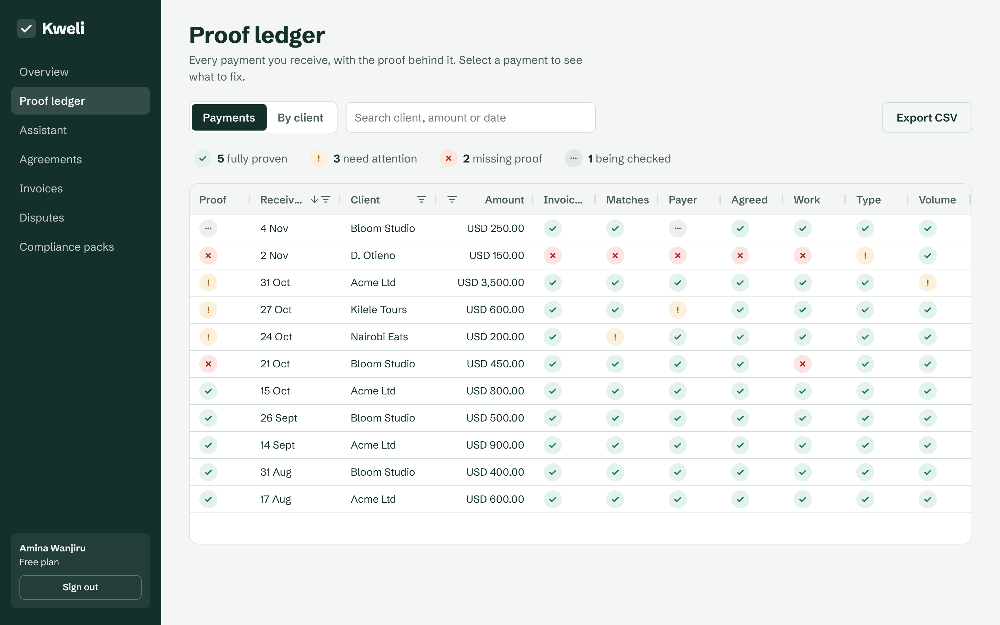
</p>

---

## 1. The Problem

Millions of freelancers in Kenya and other emerging markets are paid by overseas clients through PayPal. In 2026 this became risky for them:

- Kenya is on the **FATF grey list**, so payment providers must apply enhanced due diligence to cross-border payments.
- In **June 2026**, Kenyan users reported **frozen balances and permanently banned accounts**, after being asked to prove their employment and residence ([Business Daily](https://www.businessdailyafrica.com/bd/economy/paypal-freeze-block-kenya-accounts-in-money-laundering-fears-5482790), [WeeTracker](https://weetracker.com/2026/06/03/kenyans-furious-paypal-frozen-accounts-freelancers/)).
- Reviews asked for **contracts, invoices, bank statements and proof of address**. Many honest freelancers had never kept them, because work was agreed over WhatsApp and paid by a "send money" link.
- Funds can be held for **up to 180 days**, and accounts left non-compliant for longer can be closed.

The freelancers weren't doing anything wrong. They just **couldn't prove that they weren't**.

## 2. The Solution

Kweli makes **compliance a by-product of getting paid**. Every payment is born with its proof attached:

```
Client agreement  →  PayPal invoice  →  Payment  →  Deliverable  →  ✅ Proof chain complete
   (accepted)         (Invoicing API)    (webhook)    (uploaded)
```

| Feature | What it does | PayPal tech |
|---|---|---|
| **1. Engagement agent** | Paste a WhatsApp/email thread → the agent drafts a plain-language engagement agreement → the client accepts it through a link, and the timestamp is recorded | — |
| **2. Assistant** | "Invoice Acme for the logo, due in 7 days" → the assistant finds the agreement and prepares the invoice → you approve the card → Kweli creates and sends a real PayPal invoice tied to the agreement | Invoicing v2 (draft, send, remind) · Agent Toolkit read tools: `get_invoice`, `list_invoices`, `list_transactions` |
| **3. Proof ledger** | Every incoming payment is matched to its invoice, agreement and deliverable. Gaps are flagged with a plain reason and a fix you can make in place: upload the work, upload the client's confirmation of a third-party payment, or link a payment that didn't come through an invoice to its agreement. Search, filter by status or client, see readiness by client, export to CSV | Webhooks, Invoicing v2, Transaction Search |
| **4. Readiness score** | One score out of 100 for how ready you are for a PayPal review, and a "fix next" list in priority order with the points each fix wins ([how it's scored](docs/readiness.md)) | — |
| **5. Compliance Pack** | When an information request arrives, one click builds a PDF + ZIP: a cover letter, a payment-to-document mapping table, agreements, invoices and deliverables, **each cited**. A citation validator blocks any letter that cites a missing document or a wrong amount ([how](docs/compliance-pack.md)) | Invoicing v2, Transaction Search (the records it maps) |
| **6. Dispute defender** | A client opens a dispute → Kweli re-reads it from PayPal, builds the evidence checklist for that dispute reason from your records, drafts a checked response *(you approve)* and submits it with the agreement, invoice and delivered work attached ([how](docs/disputes.md)) | Disputes v1: show dispute, `provide-evidence` (multipart), sandbox `require-evidence` / `adjudicate` · `CUSTOMER.DISPUTE.*` webhooks |
| **7. Kweli Pro billing** | Subscriptions for Kweli itself, paid through PayPal | Subscriptions API |

### Why it's good for PayPal too
Kweli doesn't help anyone get around checks. It **helps honest users pass them**. PayPal gets better-documented emerging-market accounts and fewer false-positive reviews, and it keeps serving a fast-growing freelancer market instead of losing it to alternatives.

### Screenshots
Captured from the seeded demo (`python -m scripts.seed --demo-data`), so every client and payment is synthetic.

<details>
<summary><b>Open the screenshots</b> (14 images)</summary>

#### Sign in
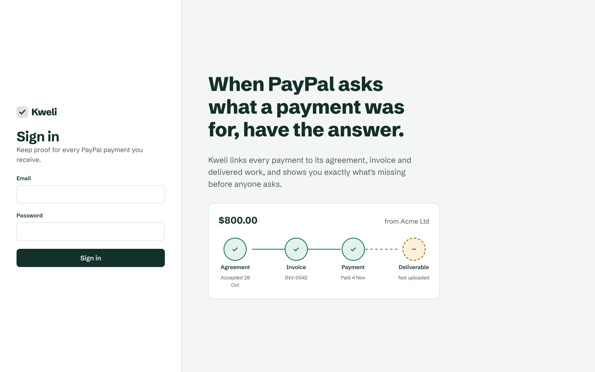

#### A payment explained
Selecting a payment shows each check in plain words. Here the client was Kilele Tours, but someone else paid.
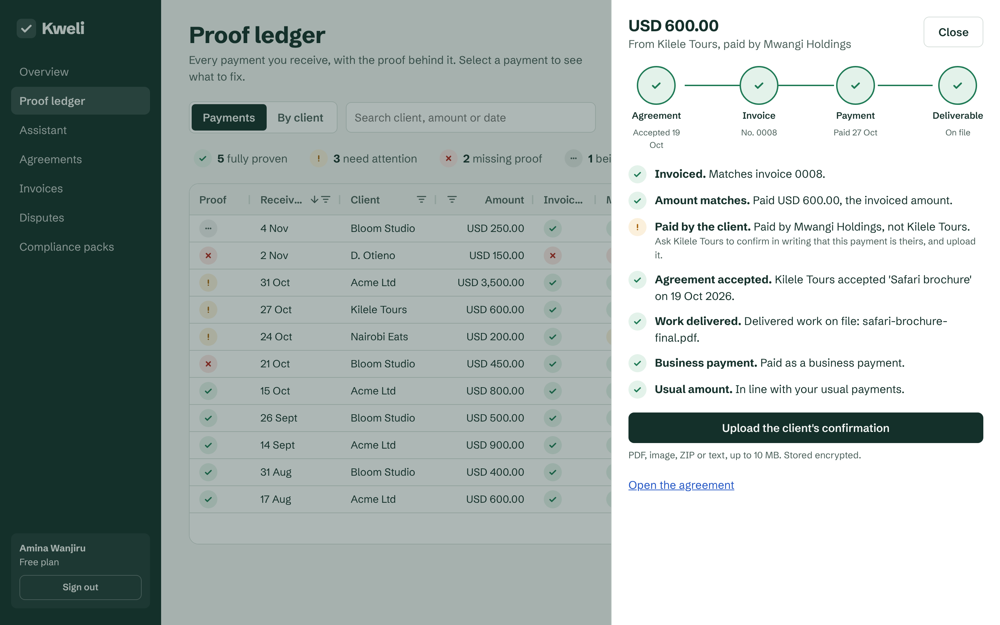

#### Fixed in place
The delivered work was missing, so the freelancer uploaded it from the drawer. The file is encrypted in the vault and the payment turns fully proven.
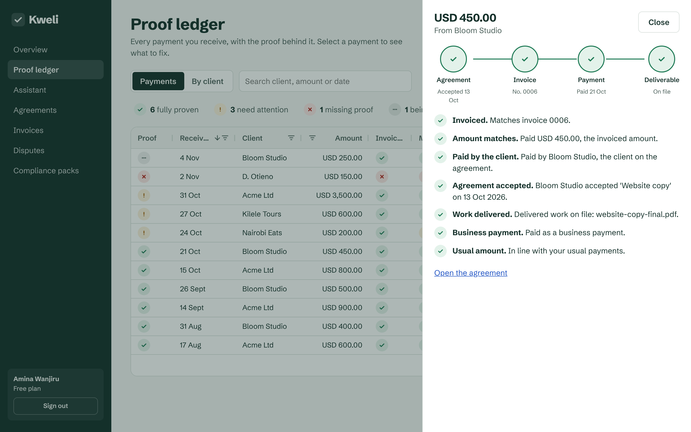

#### An agreement from a WhatsApp conversation
Paste the chat and Kweli fills in the agreement for you to check. It flags what's missing (here, the due date). The model output is stubbed in this capture; the form and checks are the real UI.
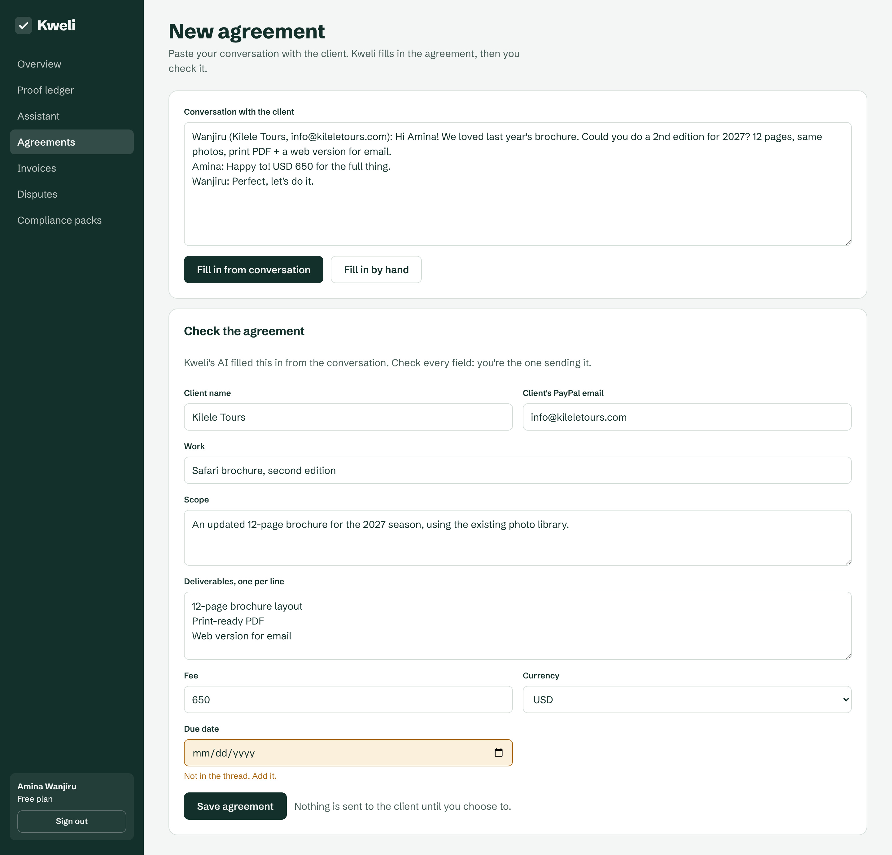

#### The proof chain for one agreement
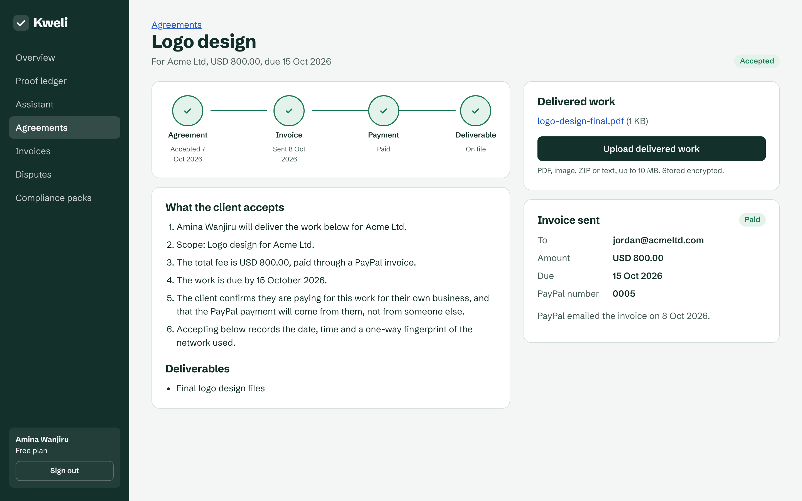

#### The assistant prepares, you approve
The assistant can only propose. The recipient and amount on the card come from the agreement in the database, not from the model. The reply text is stubbed in this capture; the proposal and its approval card are real.
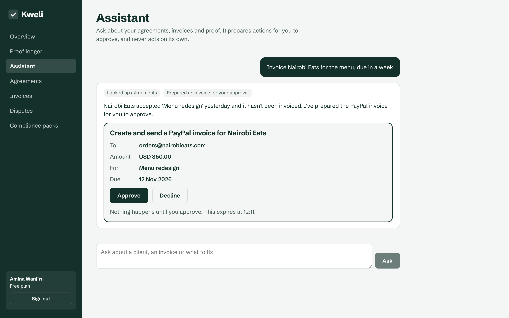

#### The client accepts on their phone
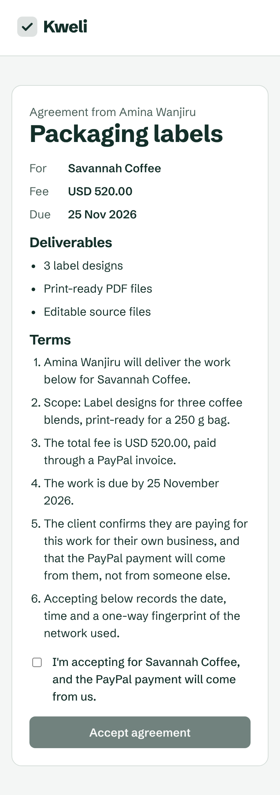

#### The ledger on a phone
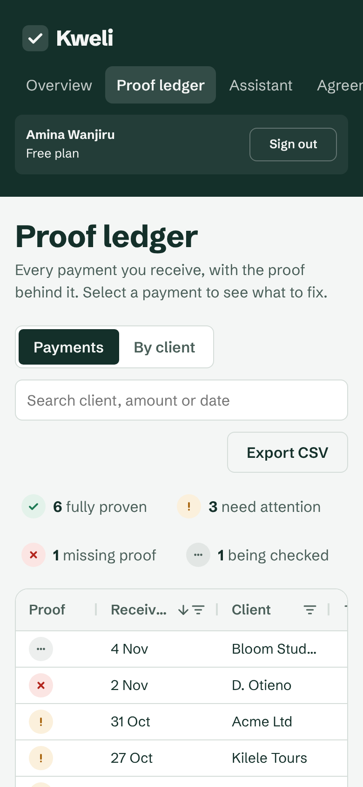

#### Readiness: what to fix, in order
One score for how ready you are for a PayPal review, and the fixes ranked by how much each one matters.
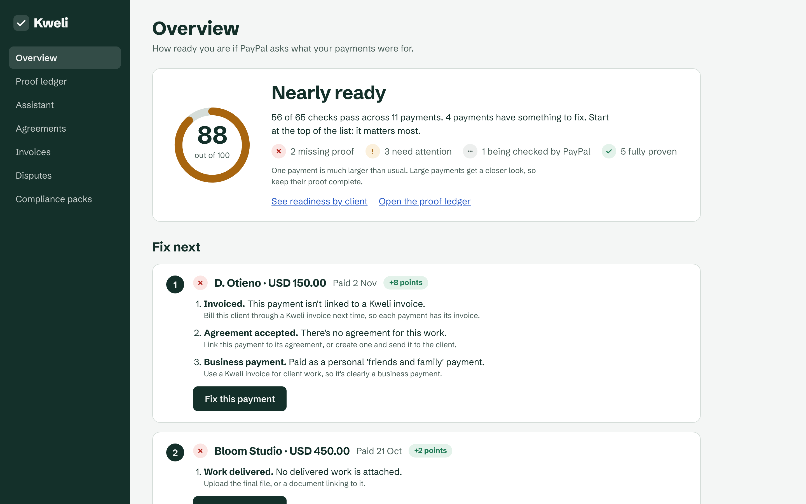

#### Readiness by client
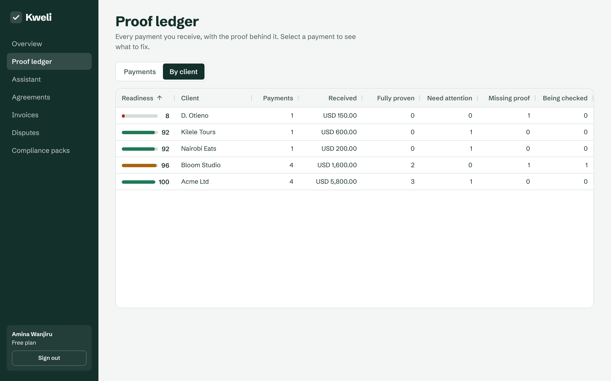

#### A Compliance Pack
One click builds a PDF and ZIP. Every claim in the cover letter cites a payment [P…], a document [D…] or Table 1 [T1].
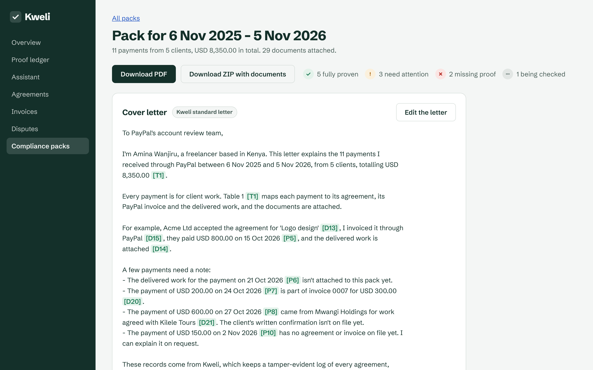

#### The citation validator blocks a wrong amount
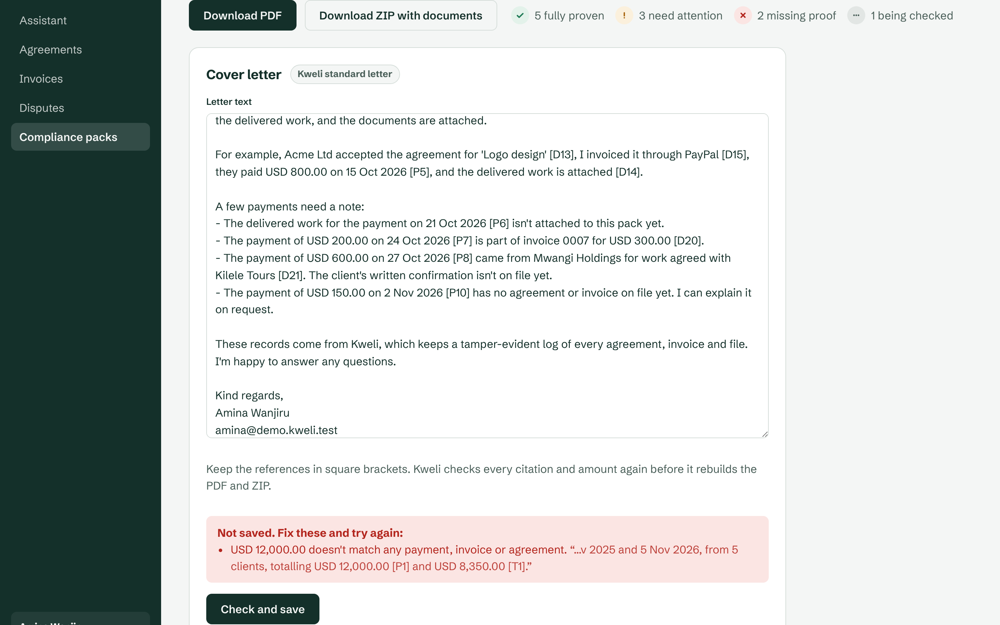

#### The dispute defender
The evidence checklist for this dispute reason, built from Kweli's records, and a checked response that only goes to PayPal after approval. This is the seeded demo dispute, so Kweli refuses to send it.
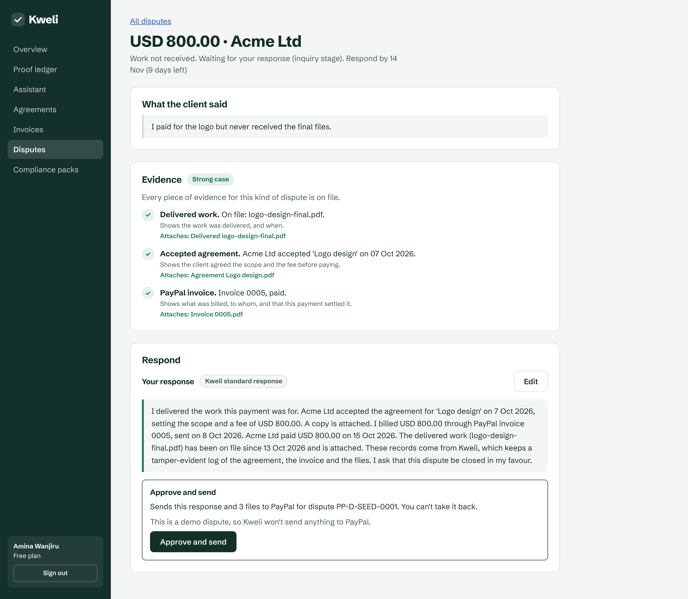

</details>

## 3. Glass Box Agent Design

Kweli's AI drafts and acts. **Deterministic rules decide what counts as proof.**

| Layer | Role | Can it be wrong silently? |
|---|---|---|
| **LLM (Claude, tool use)** | Reads threads, answers questions with Kweli's and PayPal's data, and *proposes* actions | No: proposals only take IDs; amounts and recipients come from the database |
| **Proof rules (Python)** | Decide whether a payment is documented: invoice match, amount match, payer = client, deliverable present | No: deterministic, unit-tested and explained per rule |
| **Citation validator** | Every document the LLM cites must exist in the vault, and every amount must match the ledger. Otherwise the draft is blocked | — |
| **Human approval gate** | Sending an invoice and submitting dispute evidence both need an explicit click, with a single-use token bound to exactly what will be sent | — |
| **Hash-chained audit log** | Records every agent action and approval, and makes any later edit detectable | — |

### Proof rules (v1)

| ID | Rule | Example explanation shown to the user |
|---|---|---|
| `P1` | Payment linked to a Kweli invoice | "Payment of $800 matches invoice INV-0042." |
| `P2` | Amount and currency match the invoice | "Paid $750 against an $800 invoice. Record the partial payment or ask the client to pay the balance." |
| `P3` | Payer = the client named on the agreement | "Paid by a third party (not Acme Ltd). Ask the client to confirm in writing." |
| `P4` | A signed or accepted agreement exists | "No agreement on file for this client. Send one for acceptance." |
| `P5` | Deliverable or proof of work attached | "No deliverable attached. Upload the final file or a link." |
| `P6` | Payment type fits business use | "Received as personal/'friends & family'. Use invoices for client work." |
| `P7` | Unusual volume for this account | "3× your 90-day average from a new payer. Make sure P1–P5 are complete." |

## 4. Architecture

```
 ┌──────────────────────┐   ┌──────────────────────┐
 │ Freelancer dashboard │   │ Client portal        │
 │ Refine + AG Grid     │   │ accept agreement     │
 └──────────┬───────────┘   └──────────┬───────────┘
            └────────────┬─────────────┘
                         ▼
                ┌──────────────────┐      ┌────────────────────────┐
                │ FastAPI backend  │◄─────│ PayPal Webhooks        │
                │ auth · RBAC      │      │ (signature verified)   │
                └───┬─────────┬────┘      └────────────────────────┘
                    │         │
        ┌───────────▼──┐   ┌──▼─────────────────┐
        │ Kweli agent  │   │ Proof rules engine │
        │ Claude +     │   │ P1–P7 + validator  │
        │ PayPal Agent │   └──┬─────────────────┘
        │ Toolkit      │      │
        └──────┬───────┘      ▼
               │        ┌───────────────────────────┐
               ▼        │ Postgres: ledger, vault   │
      ┌───────────────┐ │ index, audit log (hashed) │
      │ PayPal APIs   │ └───────────────────────────┘
      │ Invoicing ·   │       Encrypted document store
      │ Disputes ·    │
      │ Transactions ·│
      │ Subscriptions │
      └───────────────┘
```

## 5. Tools Used (AI and PayPal)

| Tool | How Kweli uses it |
|---|---|
| **Claude (Anthropic API, tool use)** | The assistant's reasoning and tool calls, and structured extraction from client threads. It reads and proposes; a person approves |
| **PayPal Agent Toolkit (Python)** | PayPal's official tool definitions for `get_invoice`, `list_invoices` and `list_transactions`, executed through Kweli's hardened PayPal client ([why](docs/decisions/0001-agent-toolkit.md)) |
| **PayPal REST APIs (sandbox)** | Invoicing v2, Disputes v1 (`provide-evidence`, plus the sandbox-only `require-evidence`/`adjudicate` to show the full lifecycle), Transaction Search, Subscriptions, Webhooks + signature verification |
| **AG Grid** | Proof ledger: a badge per proof rule, quick search, status and client filters (external filter), date, text and number column filters, a readiness-by-client view, and CSV export. Only the Community modules used are registered |
| **Render** | Hosting for the API, frontend, Postgres and background worker |

## 6. Tech Stack

| Concern | Choice |
|---|---|
| Backend | Python 3.11+, FastAPI, Pydantic, SQLAlchemy + Alembic |
| Agent | Anthropic SDK tool use + `paypal-agent-toolkit` tool specs + approval gate ([docs/agent.md](docs/agent.md)) |
| Frontend | React + TypeScript + Refine (headless) + **AG Grid**, custom design system |
| PDF | WeasyPrint (Compliance Pack) |
| Storage | PostgreSQL; documents encrypted (AES-GCM) on disk/object storage |
| Hosting | **Render** (web service, static site, Postgres, background worker) |
| CI | GitHub Actions: lint, type-check, tests, secret scan |

## 7. Repository Structure

```
kweli/
├── api/
│   ├── main.py
│   ├── routes/               # auth, clients, agreements, invoices, ledger, packs, disputes, webhooks, billing
│   ├── security.py           # sessions, RBAC, rate limits
│   └── db/                   # models + migrations
├── paypal/
│   ├── client.py             # OAuth (client credentials), retries, idempotency keys
│   ├── webhooks.py           # signature verification + event routing
│   ├── invoicing.py · disputes.py · transactions.py · subscriptions.py
├── agent/
│   ├── runtime.py · tools.py # assistant loop, read and propose tools
│   ├── actions.py            # approval gate: proposals, single-use tokens, execution
│   ├── toolkit.py            # PayPal Agent Toolkit tools on Kweli's PayPal client
│   ├── prompts/              # system prompts (versioned)
│   ├── extract.py            # thread → structured engagement
│   └── validators.py         # citation + amount checks, approval gate
├── proof/
│   ├── rules.py              # P1–P7
│   ├── matcher.py            # payment ↔ invoice ↔ agreement ↔ deliverable
│   └── score.py              # readiness score
├── packs/                    # Compliance Pack (PDF + ZIP)
├── audit/                    # hash-chained log
├── web/                      # Refine + AG Grid frontend
├── tests/
├── scripts/check_paypal.py   # verifies sandbox credentials + features
├── docs/                     # setup guides, API contract, interview guide
├── render.yaml               # Render Blueprint
├── docker-compose.yml
├── LICENSE
└── README.md
```

## 8. Run It Yourself

Step-by-step guides: [PayPal sandbox](docs/setup-paypal-sandbox.md) · [Render](docs/setup-render.md) · [Webhooks](docs/webhooks.md) · [API contract](docs/api-contract.md) · [Contributing](CONTRIBUTING.md)

### Prerequisites
- A PayPal Developer account (free) with a **sandbox Business** account (the freelancer) and a **sandbox Personal** account (the client)
- A REST app with **Invoicing** and **Disputes** enabled under app features
- An Anthropic API key (optional: without it, everything except the assistant and thread reading still works)

### Setup
```bash
git clone https://github.com/ByteGigs-Labs/kweli.git && cd kweli
cp .env.example .env     # PAYPAL_CLIENT_ID, PAYPAL_CLIENT_SECRET, PAYPAL_WEBHOOK_ID, ANTHROPIC_API_KEY, ...
docker compose up --build            # API + Postgres; runs migrations on start
# API: http://localhost:8000/health · docs at http://localhost:8000/docs

# Demo login (set DEMO_USER_PASSWORD in .env first, 10+ characters)
docker compose exec api python -m scripts.seed

# Web app (proxies /v1 to the API, so the session cookie stays same-origin)
cd web && npm install && npm run dev  # http://localhost:5173

# Check the PayPal sandbox app (credentials + enabled features)
python3.12 -m venv .venv && source .venv/bin/activate && pip install -r requirements-dev.txt && pip install --no-deps -r requirements-nodeps.txt
python -m scripts.check_paypal
python -m scripts.create_sandbox_invoice --to <sandbox-client-email> --amount 10.00 --send
```

To receive webhooks locally, expose the API (for example with `cloudflared tunnel`) and register `https://<tunnel>/v1/webhooks/paypal` in your app's webhook settings.

### Demo path (about 3 minutes)
1. Log in with the seeded demo freelancer.
2. Paste a client thread → the agent drafts an agreement → open the client link → **Accept**.
3. Open **Assistant** and ask: *"Invoice them for the logo, due in 7 days"* → check the approval card → **Approve** → the invoice arrives in the sandbox client's inbox → pay it.
4. Watch the payment land in the **Proof ledger** with a full ✅ chain, while an old third-party payment shows ⚠ P3 and its fix.
5. Open **Overview**: the readiness score and the "fix next" list. Fix one in place and watch the score move.
6. Open **Compliance packs** → **Build the pack** → download the PDF with every payment mapped to cited documents. Try editing the letter with a wrong amount: the validator blocks it.
7. Open a sandbox dispute as the buyer → it appears in **Disputes** with its evidence checklist → **Prepare the response** → **Approve and send** → decide it with the sandbox tools.

## 9. Security & Privacy

- **Secrets:** PayPal and LLM keys exist only on the server (Render env vars), never in the browser.
- **Webhooks:** each event is verified with PayPal's verify-webhook-signature API and deduplicated by event ID (replay-safe).
- **Approval gate:** the assistant can only read and propose. Every action needs a single-use, 15-minute approval token that goes to your browser, never to the model, and proposals can't set amounts or email addresses. Details in [docs/agent.md](docs/agent.md).
- **Prompt-injection defence:** client messages and documents are treated as untrusted data in a separate content channel, and tool calls from them are blocked unless the user approves them.
- **Documents:** encrypted at rest (AES-GCM, per-user keys wrapped by a master key), served via short-lived signed URLs, with MIME and size checks on upload.
- **No fabrication:** Kweli never generates receipts, addresses, statements or backdated agreements. It only organises real documents, and every agreement carries its true acceptance timestamp.
- **Sessions:** httpOnly + Secure + SameSite cookies, Argon2 password hashing, rate-limited login.
- **Audit:** a hash-chained log of every agent action and approval.
- **Data protection:** designed around the Kenya Data Protection Act 2019 (minimisation, export and delete on request).

## 10. Business Model

| Plan | For | Price (indicative) |
|---|---|---|
| **Free** | New freelancers | 3 clients, ledger + readiness score |
| **Pro** | Active freelancers | Monthly subscription via **PayPal Subscriptions**: unlimited clients, Compliance Packs, dispute defender |
| **Agency** | Small agencies and teams | Per-seat pricing, team ledger, subcontractor records |
| **Partners** | Freelance platforms, coworking spaces, digital-work programmes | Bulk licences and white-label |

## 11. Limitations (honest)

- PayPal has **no public API for account-limitation information requests**. Kweli prepares the pack, and the user uploads it in PayPal's Resolution Center.
- Kweli improves documentation. **It cannot guarantee that PayPal will lift a limitation.**
- Transaction Search data can be delayed in the sandbox, so the live demo relies on webhooks and Invoicing for real-time matching.
- Kweli is not legal or financial advice.

## 12. Team

| Name | Owns |
|---|---|
| — | CI/CD + Render, auth, proof rules engine, AG Grid ledger, readiness score, audit log, PayPal billing |
| — | PayPal agent, agreements + client portal, invoicing, document vault, Compliance Pack, dispute defender |

## 13. License

[MIT](LICENSE)
